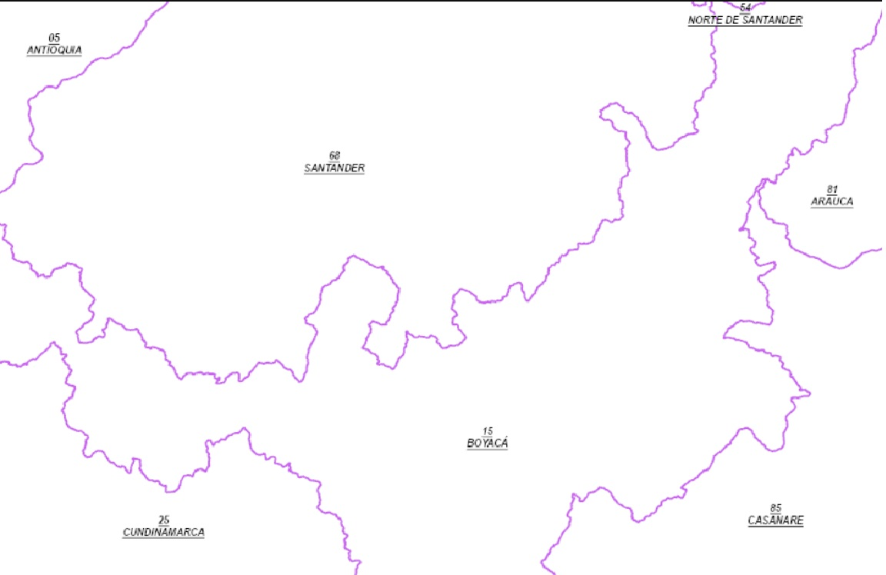
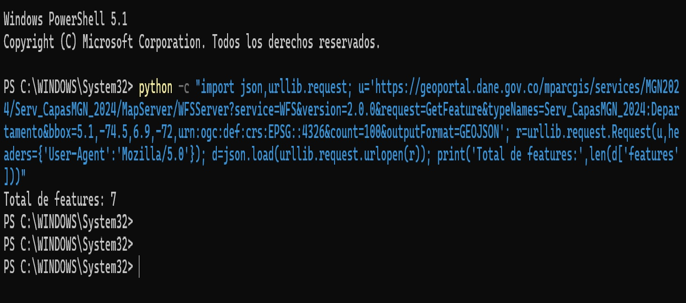

# Capítulo 2. Explorar y consumir servicios OGC existentes

## 1. Servicio WMS – GetCapabilities

Se consultó el servicio WMS del DANE correspondiente al Marco Geoestadístico Nacional 2024 (MGN2024).

| Capa | Identificador | Sistemas de referencia |
|---|---|---|
| Municipio | 7 | CRS:84, EPSG:4326, EPSG:3857, EPSG:102100 |
| Departamento | 8 | CRS:84, EPSG:4326, EPSG:3857, EPSG:102100 |

**Formatos:** BMP, JPEG, TIFF, PNG, GIF y SVG.

**Versión:** WMS 1.3.0.
## 2. Servicio WMS – GetMap

Se consultó la capa Departamento (8) del servicio WMS del DANE para visualizar el área de Boyacá, Colombia.

- Sistema de referencia: EPSG:4326.
- Formato: image/png.
- Operación: GetMap.
- https://portalgis.dane.gov.co/mparcgis/services/MGN2024/Serv_CapasMGN_2024/MapServer/WMSServer?service=WMS&version=1.1.1&request=GetMap&layers=8&styles=&srs=EPSG:4326&bbox=-74.5,5.1,-72.0,6.9&width=800&height=600&format=image/png
- 
- ## 3. WFS – GetFeature

Se consultó el servicio WFS del DANE mediante la operación GetFeature, utilizando la capa Departamento y un filtro espacial BBOX para delimitar el área de consulta.

**URL de consulta:**

https://geoportal.dane.gov.co/mparcgis/services/MGN2024/Serv_CapasMGN_2024/MapServer/WFSServer?service=WFS&version=2.0.0&request=GetFeature&typeNames=Serv_CapasMGN_2024:Departamento&bbox=5.1,-74.5,6.9,-72,urn:ogc:def:crs:EPSG::4326&count=100&outputFormat=GEOJSON

**Formato de salida:** GeoJSON.

**Filtro aplicado:** BBOX (filtro espacial).

**Conteo de features:** 7 entidades, verificadas mediante Python utilizando la función `len()` sobre la colección `features`.
**Evidencia:**

